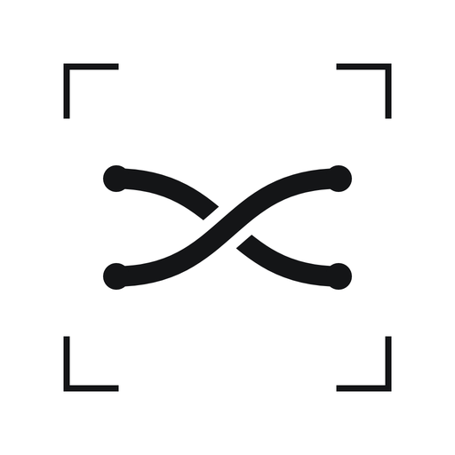
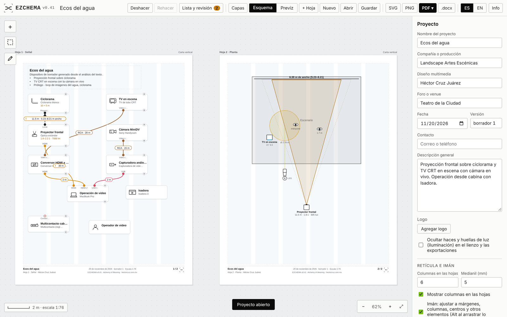
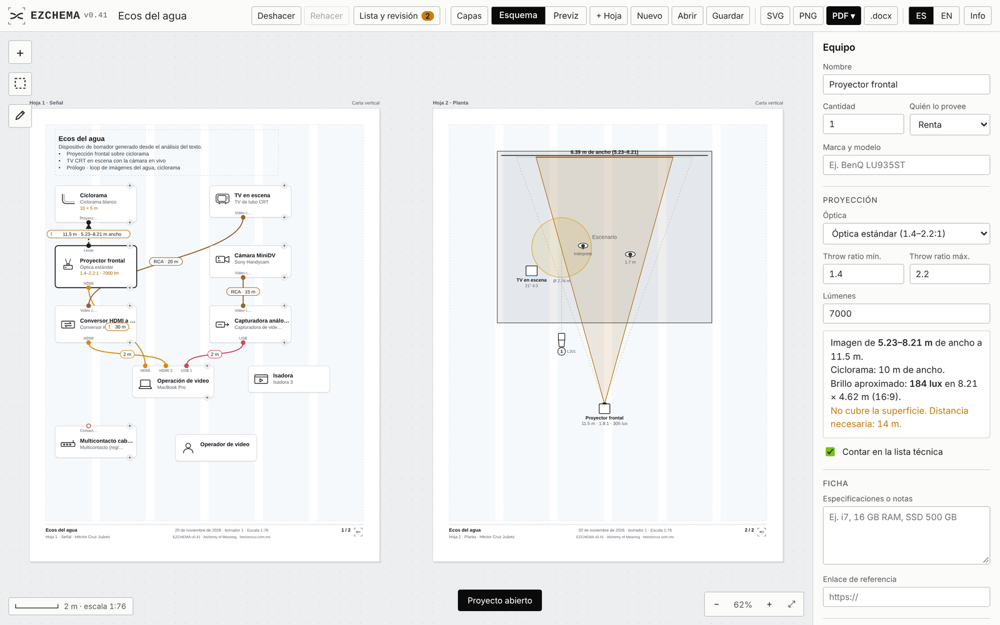
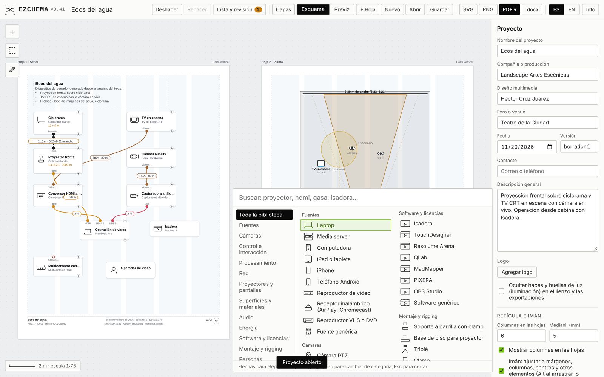
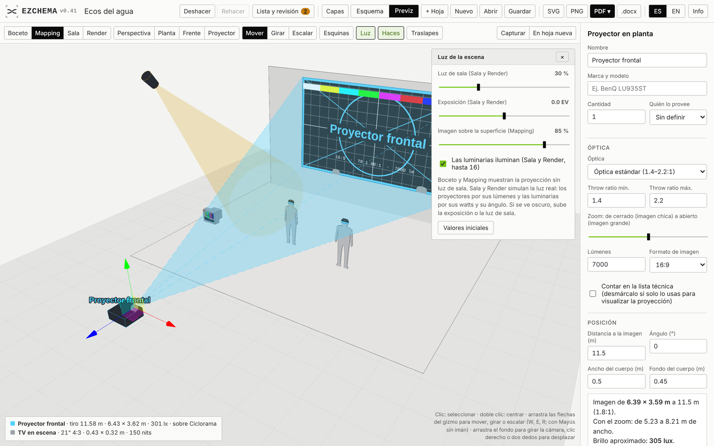

# EZCHEMA · v0.41

Maquetador libre de diagramas de montaje y señal, plantas a escala y previsualización 3D para proyectos multimedia escénicos: teatro, danza, música e instalación.

Es un solo archivo HTML. Se abre en cualquier navegador, sin instalación ni cuenta, y funciona sin internet (salvo la Previz 3D, que carga three.js al abrirse). En iPad y iPhone se instala como app desde Safari (Compartir, Agregar a pantalla de inicio).

**Usarlo en línea:** https://loquellega.github.io/ezchema/

## Qué hace

- **Diagrama de señal:** tarjetas de equipo con puertos y cables por tipo (HDMI, SDI, video análogo RCA, red, USB, control, audio, corriente eléctrica), con largos y quién provee cada cosa.
- **Planta a escala:** escenario, muros, escenografía, proyector en planta con throw ratio, zoom y lux, luminarias con haz, huella y patch DMX, pantallas emisoras (TV CRT, pantalla plana, monitor de piso, muro LED plano y curvo) y figuras humanas de escala.
- **Previz 3D:** la planta en volumen, con la proyección real (imagen o video, editor de cuatro esquinas), luminarias que iluminan, estilos Boceto, Mapping, Sala y Render, gizmo para mover, girar y escalar, y capturas que se actualizan en las hojas.
- **Revisión automática:** adaptadores que faltan, cables demasiado largos, imagen que no cubre la superficie, traslapes DMX.
- **Lista técnica** con descripción del proyecto y glosario opcional, en PDF vectorial, Word (.docx) y CSV.
- **Hojas carta, A4, tabloide o A3** dentro del lienzo, exportadas como páginas en vectores.
- **Equipo análogo y energía:** cámaras DV y de circuito cerrado, DVR, VHS, conversores VGA y HDMI a RCA, tomas, extensiones, multicontactos y no-break.
- **Servidor privado opcional** (carpeta `servidor/`, PHP con contraseña) para guardar y abrir proyectos desde tu sitio.
- **Formato abierto:** los proyectos son `.json`. En [`docs/ezchema-formato-proyecto.md`](docs/ezchema-formato-proyecto.md) está la especificación para generarlos desde otras herramientas.

| | |
|---|---|
|  |  |

## Interfaz

Desde la v0.41 usa **Alchemy UI** en su versión luminosa, el estilo de la colección: líneas de 1 px, sin sombras, rótulos chicos con cifras tabulares, y el verde solo para lo activo (selección, modo, progreso). El tema oscuro usa la paleta original de la colección. El lienzo y las hojas no cambian: el contenido manda.

## Cómo correrlo

- **Local:** descarga el repositorio y abre `index.html`.
- **En tu hosting:** sube `index.html`, los íconos y, si quieres guardar en tu sitio, la carpeta `servidor/` (instrucciones en `servidor/LEEME-servidor.txt`). Al actualizar, reemplaza solo `index.html`.

Historial de versiones en [`LEEME.txt`](LEEME.txt).

## Licencia

Software libre bajo la [GNU General Public License v3.0](LICENSE). Incluye [jsPDF](https://github.com/parallax/jsPDF) y [svg2pdf.js](https://github.com/yWorks/svg2pdf.js) (MIT); la Previz carga [three.js](https://threejs.org) (MIT).

## Créditos

Diseño, investigación y desarrollo: Héctor Cruz Juárez — https://hectorcruz.com.mx
Colección Alchemy of Meaning (Alquimia del Significado).

---

## English

**Ezchema** is a free tool for rigging and signal diagrams, scaled plans and 3D previsualisation for multimedia performance projects: theatre, dance, music and installation. It is a single HTML file that runs in any browser, with no installation or account, and works offline (except the 3D Previz, which loads three.js when opened). Switch the interface with the **ES / EN** buttons.

- Signal diagram with typed ports and cables (HDMI, SDI, analogue RCA video, network, USB, control, audio, mains power).
- Scaled plan: stage, walls, set pieces, plan projector (throw ratio, zoom, lux), lighting fixtures with DMX patch, emissive screens (CRT TV, flat screen, wedge monitor, flat and curved LED wall) and human scale figures.
- 3D Previz: projected image or video with corner editor, fixtures that cast light, Sketch, Mapping, Venue and Render styles, move/rotate/scale gizmo and captures placed on sheets.
- Automatic review and technical list (optional glossary) exported to vector PDF, Word (.docx) and CSV.
- Open `.json` format, documented in `docs/ezchema-formato-proyecto.md`.

Since v0.41 the interface uses the luminous version of **Alchemy UI**, the collection's style.

Free software under the [GNU General Public License v3.0](LICENSE).
Design, research and development: Héctor Cruz Juárez — https://hectorcruz.com.mx · Alchemy of Meaning collection.
